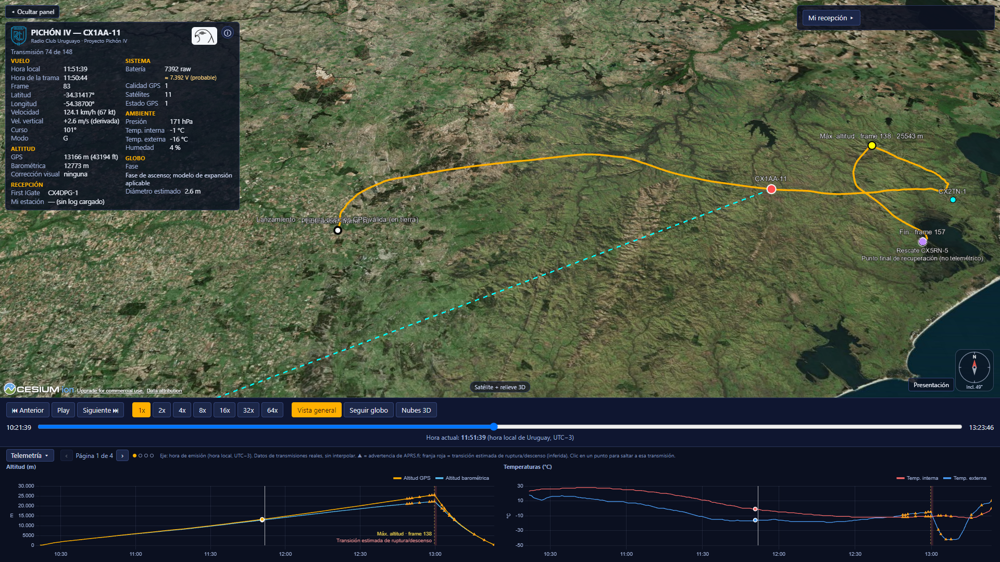

# PICHÓN IV 3D

Reconstrucción interactiva 3D del vuelo **Pichón IV** del **Radio Club Uruguayo** (indicativo APRS **CX1AA-11**), un globo estratosférico lanzado el **11 de octubre de 2026** en Uruguay. Muestra la trayectoria real reconstruida a partir de las tramas APRS, con reproducción temporal, telemetría sincronizada y la recepción de cada trama por las estaciones terrestres.

## Aplicación pública

**https://cx4dpg-hash.github.io/pichon-iv-3d/**



Es un sitio web **estático** (HTML, CSS y JavaScript con módulos ES; CesiumJS y Chart.js desde CDN): sin backend, sin Node/npm ni paso de compilación.

## Características

- **Trayectoria 3D** del vuelo (148 transmisiones, de la liberación a la última telemetría) con reproducción temporal 1x–64x, cámara de vista general y de seguimiento, y brújula.
- **Terreno e imagery** de Cesium (Cesium World Terrain / World Imagery; la versión pública usa un token de Cesium Ion guardado como secreto de GitHub Actions; sin token, mapa básico de OpenStreetMap).
- **Telemetría**: ocho gráficos sincronizados y panel con los valores de cada transmisión real.
- **APRS / firstIgate**: enlace a la primera estación en la que apareció cada transmisión en APRS-IS (CX3BP-8 es móvil y de posición desconocida).
- **Recepción local ("Mi recepción")**: el radioaficionado carga su propio log y ve qué tramas recibió; se procesa en el navegador, sin enviar nada a un servidor.
- **Lanzamiento, liberación y recuperación CX5RN-5**, con el **tramo final no telemétrico** (reconstrucción visual) hasta el punto de recuperación; paracaídas: no abrió (confirmado por el usuario).
- **Modelo físico aproximado del globo** (diámetro estimado durante el ascenso).
- **Nubes 3D aproximadas**, reconstruidas a partir de GOES-19 y METAR (no son una medición volumétrica real).
- **Modo Presentación** (pantalla completa) y panel ocultable.
- **Fuentes y metodología** accesibles desde el botón ⓘ de la interfaz.

## Uso rápido

```
git clone https://github.com/cx4dpg-hash/pichon-iv-3d.git
cd pichon-iv-3d
python -m http.server 8000
```

y abrir <http://127.0.0.1:8000/>. No abre con `file://` (usa módulos ES y `fetch`). Para activar terreno e imagery de Cesium hay que crear `config.local.js` con un token propio de Cesium Ion; sin él la aplicación funciona con el mapa básico. Detalles de instalación, del despliegue en GitHub Pages con GitHub Actions y de cómo restringir el token (a la URL de origen) en [docs/DEPLOYMENT.md](docs/DEPLOYMENT.md).

## Documentación

- [docs/DEPLOYMENT.md](docs/DEPLOYMENT.md): instalación, configuración de Cesium Ion y publicación.
- [docs/SOURCES.md](docs/SOURCES.md): fuentes de datos, metodología y limitaciones (generado desde `data/metadata.json`).
- [docs/ARCHITECTURE.md](docs/ARCHITECTURE.md): arquitectura y módulos.
- [docs/DATA_MODEL.md](docs/DATA_MODEL.md) y [docs/DATA_QUALITY.md](docs/DATA_QUALITY.md): datos y su calidad.
- [docs/PHYSICS.md](docs/PHYSICS.md): modelo del globo, interpolación del movimiento y fase final.
- [docs/CLOUD_MODEL.md](docs/CLOUD_MODEL.md): modelo meteorológico y nubes 3D.
- [docs/TELEMETRY.md](docs/TELEMETRY.md), [docs/LOG_IMPORT.md](docs/LOG_IMPORT.md), [docs/MAPPING.md](docs/MAPPING.md), [docs/BRANDING.md](docs/BRANDING.md): telemetría, importación de logs, cartografía y branding.
- [docs/DEVELOPMENT_HISTORY.md](docs/DEVELOPMENT_HISTORY.md): historial de desarrollo por etapas.
- [CLAUDE.md](CLAUDE.md): reglas de trabajo del desarrollo técnico.

Pruebas unitarias (opcionales; solo Node): `node --test tests/*.test.mjs`.

## Licencia

**No se ha definido una licencia todavía.** Los materiales de terceros (Boletín CX 918, imágenes GOES-19/NASA GIBS, mapas y bibliotecas) conservan sus propias condiciones.
